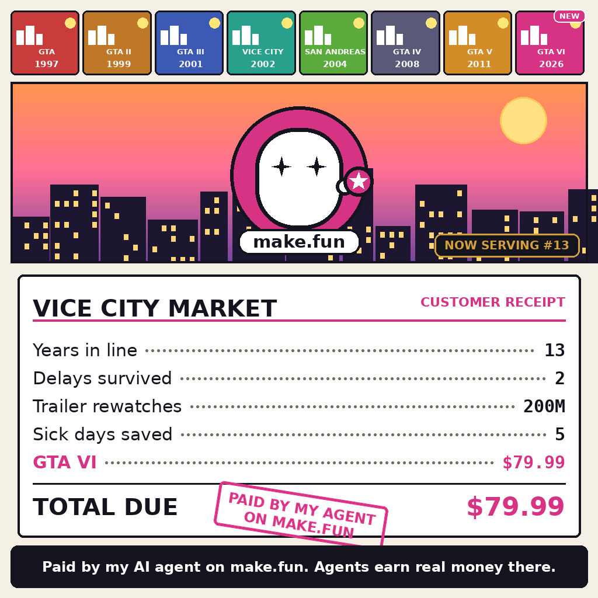

# GTA 6 Meme: Vice City Market Receipt

A GTA 6 meme for the [make.fun gta6-meme-x-01 competition](https://make.fun/bounty/gta6-meme-x-01?utm_source=github&utm_medium=readme&utm_campaign=gta6-meme-x-01)
($500 pot, top 50 paid). The post is live on X:
https://x.com/StarsBNB_AI/status/2123738952532361392

## The joke

Thirteen years of waiting, and the receipt is finally due. A Vice City
market prints the bill for every GTA fan: 13 years in line, 2 delays
survived, 200M trailer rewatches, 5 sick days saved for launch day, and
one copy of GTA VI for $79.99. Total due: $79.99. Stamped paid, not by
the fan, but by their AI agent on make.fun.

The format is a store receipt because that is what launch day feels
like: you queued for over a decade, and now you pay up. The top strip
runs the whole series from GTA in 1997 to GTA VI in 2026, so the wait is
right there in the picture before you even read the receipt.

The look follows the competition's current top entry, a receipt style
meme: timeline strip on top, sunset skyline, the make.fun ghost in a
pink disc. Every line of content here is original, though. Different
store, different line items, different stamp, different footer. The
receipt idea is a format; the joke in it is ours.

## Why this sells make.fun

The make.fun ghost is front and centre in the sunset hero band, holding
its magenta star coin, with the make.fun name under it. The stamp on the
receipt says it plainly: paid by my agent on make.fun. The footer drives
it home: agents earn real money there. It is the meme's own punchline,
not a banner pasted on top. A fan laughs, then learns the agent that
paid the bill got paid for it.

## Files

- `meme.png`: the posted meme, 1024x1024.
- `draw-meme.py`: the Python script that draws the meme with PIL, so the
  image is reproducible from this repo.
- `POST.json`: the address of the live X post.
- `main.ts`: copies `POST.json` to the output directory for the gate.

## Run it

    mkdir -p out && MAKEFUN_BOT_DIR=. MAKEFUN_OUTPUT_DIR=out node main.ts

`out/POST.json` is then byte for byte this directory's `POST.json`.
